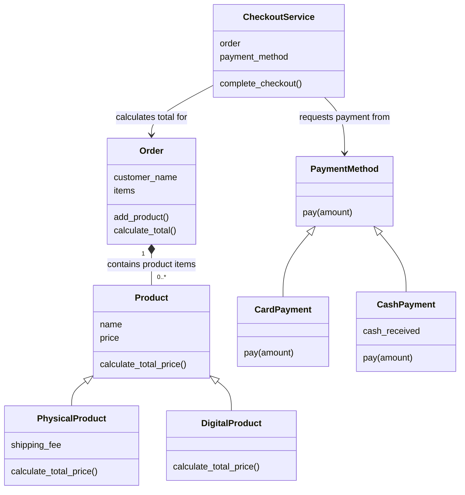

# Week 7 Assignment: Online Shopping and Payment Processing System

## 1. Assignment Question

Develop a simple Online Shopping and Payment Processing System in Python. The system should allow a customer to place an order containing different products and complete checkout using a selected payment method.

The store sells physical products, such as a keyboard or a book, and digital products, such as an e-book or an online course. These product types may have different pricing or order-cost considerations. Customers may pay using different methods, such as card or cash.

## 2. Assignment Requirements

- Represent products and their relevant information in the program.
- Support at least two product types: physical and digital.
- Allow an order to contain multiple products and calculate its total.
- Support at least two payment methods, each with its own payment behaviour.
- Provide a checkout process that calculates the order amount and invokes the selected payment method.
- Demonstrate the complete process with sample products, an order, and a payment.

## 3. Design Hints

- **Inheritance:** Consider what product types have in common and whether payment methods share an operation.
- **Polymorphism:** Consider how the same operation can produce behaviour specific to each product or payment type.
- **Composition:** Consider which objects contain or use other objects. An order contains products; checkout uses an order and a payment method.

These are design hints, not a required class structure. The design should show why the relationships and behaviours are useful.

## 4. What to Submit

- Python source code (`shopping_system.py`).
- A short class diagram or clearly labelled sketch showing the main classes and their relationships.
- Screenshots or sample output demonstrating an order with more than one product and checkout using at least two payment methods.
- A brief explanation (approximately 1/2 to 1 page) identifying where inheritance, polymorphism, and composition are used and why.

## 5. Evaluation Focus

The work is evaluated on correct functionality, suitable class responsibilities, meaningful use of inheritance, polymorphic behaviour, composition between objects, readable code, and the ability to explain design decisions.

**Important:** Inheritance, polymorphism, and composition should solve real design needs, not be added only to satisfy a checklist.

## 6. Class Diagram



## 7. Design Explanation

**Inheritance:** `PhysicalProduct` and `DigitalProduct` inherit the shared name and price fields from `Product`. A physical product adds a shipping fee, while a digital product has no shipping cost. `CardPayment` and `CashPayment` also share the `PaymentMethod` contract, so both provide the same `pay(amount)` operation.

**Polymorphism:** `Order.calculate_total()` asks every product for its `calculate_total_price()`. It does not need to check whether the product is physical or digital: the physical product includes shipping, and the digital product returns its price without shipping. Similarly, `CheckoutService` calls `pay()` on whichever payment object it receives. Card payment reports approval; cash payment checks whether enough cash was provided and calculates change. Adding another product or payment type does not require channel-specific branches in the order or checkout logic.

**Composition:** An `Order` keeps a collection of product-and-quantity entries. A `CheckoutService` keeps the order and selected payment method it needs to complete checkout. This keeps each class focused: products calculate their own costs, the order totals its items, payment methods handle their own payment rules, and checkout coordinates the process.

**Design decision:** Prices and totals use Python's built-in `Decimal` type rather than floating-point numbers, avoiding common rounding surprises with currency. Card payment is a simulation only; the program does not collect card details or contact a bank. The example creates two separate sample orders with the same products so both payment options can be demonstrated without paying the same order twice.

## 8. Sample Output

```text
--- Card checkout ---
Order for Amina:
  Keyboard (Physical) x 1: $50.00
  Paperback book (Physical) x 1: $15.50
  Python e-book (Digital) x 2: $19.98
  Order total: $85.48
Card payment approved: $85.48
Checkout complete.

--- Cash checkout ---
Order for Amina:
  Keyboard (Physical) x 1: $50.00
  Paperback book (Physical) x 1: $15.50
  Python e-book (Digital) x 2: $19.98
  Order total: $85.48
Cash accepted: $100.00; change due: $14.52
Checkout complete.
```

## 9. Run the Program

From the project folder, run:

```powershell
python ".\Assignment 2\shopping_system.py"
```
